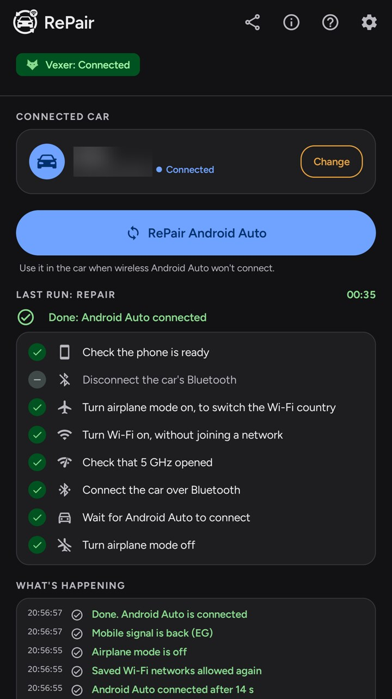
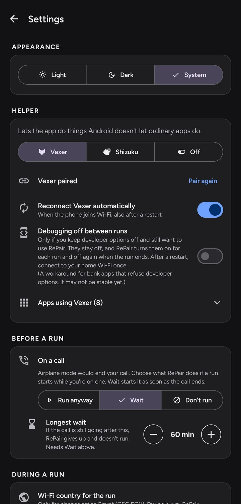
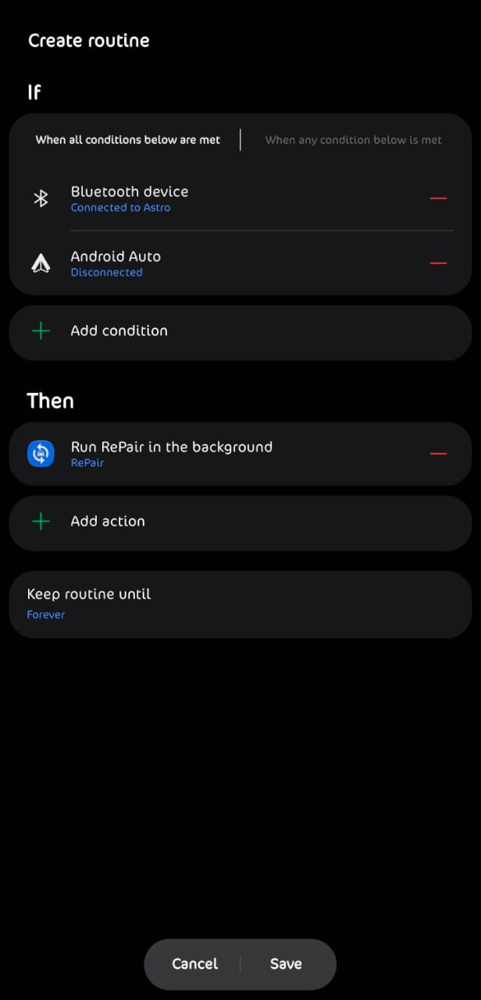
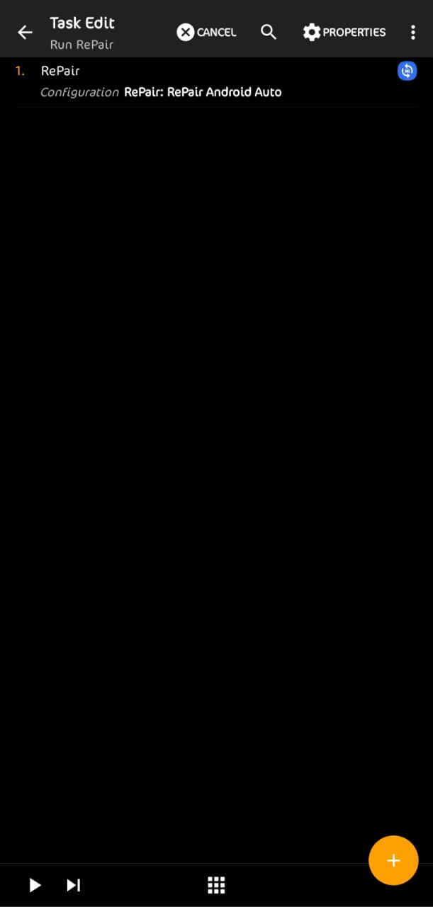

# RePair 🚗📶

**One-tap fix for wireless Android Auto when your phone's Wi-Fi country blocks the car's 5 GHz
channel.** Made and tested on a Samsung Galaxy S24 Ultra. It may work on other phones with Android
15 or newer, but that isn't proven yet. No root: uses Vexer, RePair's own helper (or Shizuku).

How it works: RePair briefly takes the mobile network out of the picture, so Wi-Fi uses another
country's rules and the car's channel opens. Once Android Auto connects, everything goes back to
normal and Android Auto keeps working.

> ⚠️ **Use at your own risk.** RePair changes system settings through its helper. I'm not
> responsible for any damage, data loss or a bricked phone.

## Watch how to set it up 🎬

Every step from the first open until RePair is ready for the car, in about 2 minutes:

https://github.com/user-attachments/assets/340f23b9-8416-4a5c-8042-273fdb70092c

## Vexer, RePair's helper 🤖

RePair needs to change a few phone settings that normal apps can't change (the Wi-Fi country and
airplane mode). For that it needs a helper with more rights than a normal app.

- Vexer is RePair's own helper. You set it up once, on the phone, with Wireless debugging. No
  computer needed.
- It connects again by itself after a restart, when the phone joins Wi-Fi.
- RePair needs one helper: Vexer or [Shizuku](https://shizuku.rikka.app/). Shizuku still works if
  you prefer it: **Settings > Helper**. (Shizuku has to be started again after every restart.
  Vexer doesn't.)
- Already set up Vexer in another of your apps? Tap **Pair** (and **Allow** if it asks). No code
  needed.

[⬇️ Download the latest version](../../releases/latest) · [What's new](CHANGELOG.md)

> **Why I made RePair:** I built it to fix wireless Android Auto on my own Samsung Galaxy S24
> Ultra, and that's the phone it's tested on. I'm sharing it because it could help other phones
> with the same problem.
>
> You're welcome to try it. Just keep in mind there are no plans to support other devices, so if
> it doesn't work on yours, it may stay that way.

  
  
  
  

<em>The app, its settings, a Samsung routine that runs it when you get in the car, and the Tasker action.</em>

## Why doesn't it connect? 🤔

Wireless Android Auto talks to your car over 5 GHz Wi-Fi. Your phone decides which Wi-Fi channels
it's allowed to use based on the country of the mobile network it sees. In some countries (Egypt,
for example) the channel some cars use, like channel 149 on Renault, isn't on that list. So the
phone simply can't see the car's Wi-Fi, and Android Auto waits forever.

## What RePair does ✨

With one tap, RePair makes your phone forget the mobile network's country for a moment, and Wi-Fi
switches to a country whose rules open the car's channel. This works whatever your phone's region
(CSC) is, Egypt (EGY) included.

Then RePair reconnects the car, waits for Android Auto to connect, and turns your mobile network
back on. Android Auto keeps working after that, because the phone doesn't change the Wi-Fi country
while it's connected.

The run log shows the open 5 GHz channels before and after, for example
`5 GHz is open (GB): channels 149 to 165 (5745 to 5825 MHz)`.

A run takes about 30 seconds (up to a minute and a half if your car is slow to wake up).

If anything goes wrong, or you tap Stop, airplane mode is turned back off, so you never lose your
mobile signal. If Android Auto is already connected, RePair doesn't touch anything.

## Will it work for you? ✅

Two things matter:

**1. Your car and your phone must support wireless Android Auto.** RePair can't add wireless
Android Auto to a car or a phone that doesn't have it. It only helps when the only thing in the
way is the Wi-Fi country.

**2. Your phone should have Android 15 or newer.** Older versions may not let RePair's helper
change the Wi-Fi settings it needs (RePair tells you if so).

Your phone's region (on Samsung, its CSC) can be any country. With a region like India (INS),
RePair uses it. Egypt (EGY) works too (tested on the S24 Ultra, at home and in the car).

### Test it by hand first (no app needed)

This works only when your phone's own region is not Egypt (not on EGY). On EGY, skip it: there's
no manual way, and RePair handles it.

1. Turn on **airplane mode**.
2. **Restart the phone.** It comes back still in airplane mode, without ever seeing the mobile
   network, so Wi-Fi follows your phone's own region instead.
3. Turn **Bluetooth** and **Wi-Fi** back on (airplane mode stays on).
4. Start the car and let **wireless Android Auto** connect.
5. Once Android Auto is running, turn **airplane mode off**. Your mobile signal comes back, and
   Android Auto keeps working.

**If this works, RePair will work for you too**, with one tap and no restart. If Android Auto
doesn't connect even this way, the problem is something RePair can't fix (the car or the phone).

## What you need 📋

- Android 15 or newer, with the latest system updates. It installs on Android 12 to 14 too, but
  the Wi-Fi switch it needs may be missing there, and RePair tells you if it is.
- Wi-Fi and Developer options, to set up **Vexer** once: RePair's own helper, set up on the
  phone, no computer needed. After a restart it connects again by itself when the phone joins
  Wi-Fi. Prefer [Shizuku](https://shizuku.rikka.app/)? It still works (Settings > Helper).
  A bank app refuses to open with Developer options on? Turn on **Debugging off between runs**
  (Settings > Helper, Vexer only): they stay off, and RePair turns them on for each run and off
  again when the run ends.
  It's a workaround and may not be stable yet.
- Any phone region (CSC). Regions proven to open the car's channel: **India**, **Sweden**,
  **UAE**, **Thailand** and **Egypt (EGY)**. RePair checks your region for you.
- Your car paired with your phone over Bluetooth.

## Getting started 🚀

🎬 New to RePair? [Watch the setup video](#watch-how-to-set-it-up-) first.

1. Download `RePair-x.y.z.apk` from [Releases](../../releases/latest) and install it. If Android
   asks, allow installing from your browser or file manager.
2. Open RePair and set up **Vexer**: connect to Wi-Fi, tap **Pair**, then *Pair device with
   pairing code* in Wireless debugging, and type the code in RePair's notification. RePair shows
   how to turn on Developer options if they're off, and its notification tells you each step.
   (Prefer Shizuku? Tap *Use Shizuku instead*, shown when Shizuku is installed.)
3. Tap **Choose**, allow Nearby devices, and pick your car.
4. The checklist on the main screen tells you if anything is still missing.

## Five ways to run it 🎛️

- **The big button** in the app: *RePair Android Auto*. You can watch every step live, with a log.
- **Quick Settings tile**: edit your Quick Settings panel and add the *RePair* tile. One tap and it
  runs in the background (your phone needs to be unlocked).
- **App shortcut**: long press the RePair icon, then *Run RePair in the background*.
- **Samsung Modes and Routines**: add an action: Apps, *Open an app or do an app action*, RePair,
  *Run RePair in the background*. It runs quietly without opening the app, for example when
  your phone connects to the car's Bluetooth.
- **Tasker**: the *RePair* plugin action gives you:
  - `%repair_status`: `true` if the run worked (or Android Auto was already connected), `false`
    if it failed
  - `%repair_result`: a few words on how it ended, e.g. `Android Auto connected` or
    `Vexer not connected`
  - `%repair_airplane_on`: `true` if the run turned airplane mode on, `false` if it stopped
    before that
  - `%repair_airplane_off`: `true` if airplane mode is off when the run ends, `false` if it's
    still on
  - `%errmsg`: only on failure, the same text as `%repair_result`
  - plus *Check status*, which changes nothing and reads `%repair_country` (the Wi-Fi country
    in use, e.g. `EG` or `IN`), `%repair_5ghz` (`true` if 5 GHz is open) and `%repair_fallback`
    (`true` if the Wi-Fi country fallback is applied).

Want to know how a background run went? Turn on a toast or a notification in **Settings, Run
results**.

## Settings ⚙️

- **On a call** (Wait by default). Airplane mode would end your call, so RePair waits for it to
  end before it starts, for up to 60 minutes (you can set 5 to 120). You can also choose Run
  anyway or Don't run.
- **Wi-Fi country for the run** (United Kingdom by default). Only used on phones set to Egypt
  (EGY): the Wi-Fi country RePair uses during the run. Choices: United Kingdom, United States, United
  Arab Emirates, Thailand and India. All five opened the car's channel in tests.
- **Wait for Android Auto**: how long RePair waits for the phone to join the car's Wi-Fi before it
  gives up, from 10 to 60 seconds (60 by default). It stops waiting as soon as the phone joins.
- **Map behind the wheel** (off by default). Made for the Renault Austral, which shows the map
  behind the steering wheel only after a navigation has started. When Android Auto connects,
  RePair starts a short Google Maps navigation on the car screen and ends it as soon as it
  starts, so the map stays there. It works with the phone locked and opens nothing on the phone. It takes
  about 15 seconds, as Google Maps counts down before it starts. *Try now* runs it at home.
- **Run results**: a toast and a notification, each set to Off, Failures only or Always.
- **Samsung routines**: pick one of your Samsung routines to start when a run starts and one to
  start when it ends. Only routines that you start manually can be picked (with just one, it's
  picked right away). If you rename one, RePair shows the new name; if you delete it, Settings
  tells you to pick another.
- **Tasker tasks**: pick one of your own Tasker tasks to run before every run (RePair waits for
  it, up to 30 seconds) and one to run after it. The after task gets `%repair_status`,
  `%repair_result`, `%repair_airplane_on` and `%repair_airplane_off`, so it can react to how the
  run went. Needs Tasker's *Allow External Access* (Preferences, Misc).
- **Theme**: Light, Dark or System.

## Handy tips 💡

- **Samsung users**: switching USB to file transfer can stop Shizuku. To avoid that, dial
  `*#0808#` in the Phone app and choose **MTP + ADB**.
- Stuck? The **Help** screen inside the app explains every step and every error message.
- Something went wrong? Tap the **share** icon at the top to send me the detailed log of your last
  5 runs. It shows exactly what happened, far more than the screen does.
- **Updates**: when a new version is out, RePair tells you once when you open it or switch back to it, and a dot on the
  **ⓘ** button reminds you until you update. Tap **Update** and RePair downloads it and opens
  Android's installer for you (the first time, Android asks you to allow RePair to install apps).
  You can also check any time from **ⓘ** or **Settings, About**, or get it from the
  [releases page](../../releases/latest).

## Privacy and battery 🔋

- RePair only goes online to **check GitHub for a newer version** when you open the app or switch back to it
  (at most once an hour), and to
  download an update when you tap Update. Nothing about you or your phone is sent, and runs from
  the tile, Routines or Tasker never go online.
- Nothing runs in the background unless you start a run. The tile and the shortcut don't keep
  anything running either.
- The log on the screen is gone when you close the app. RePair also keeps a detailed log of your
  last 5 runs on your phone, and a short history of app events (like updates and errors). They
  include your Wi-Fi network names, the Wi-Fi networks around you and
  your car's Bluetooth name, and they never leave your phone unless you share them yourself.

## Use at your own risk ⚠️

RePair changes your phone's airplane mode, Wi-Fi and system settings while it runs. It's built
to always put things back, but it comes with no warranty of any kind. You use it entirely at your
own risk, and I'm not responsible for any damage, data loss or a bricked phone.

## Credits 💙

RePair is built with these great open-source projects:

- [Shizuku](https://github.com/RikkaApps/Shizuku-API) by RikkaW, [Apache License 2.0](licenses/Apache-2.0.txt)
- [libadb-android](https://github.com/MuntashirAkon/libadb-android) by Muntashir Al-Islam, [Apache License 2.0](licenses/Apache-2.0.txt)
- [spake2-java](https://github.com/MuntashirAkon/spake2-java) by Muntashir Al-Islam, [GNU LGPL 3.0](licenses/LGPL-3.0.txt) (with the [GPL 3.0](licenses/GPL-3.0.txt) it builds on)
- [Conscrypt](https://github.com/google/conscrypt) by Google, [Apache License 2.0](licenses/Apache-2.0.txt)
- [Bouncy Castle](https://www.bouncycastle.org), [MIT License](licenses/BouncyCastle-MIT.txt)
- [Tabler Icons](https://tabler.io/icons) by Paweł Kuna, [MIT License](licenses/TablerIcons-MIT.txt)
- [AndroidX and Jetpack Compose](https://developer.android.com/jetpack) by Google, [Apache License 2.0](licenses/Apache-2.0.txt)
- [Kotlin coroutines](https://github.com/Kotlin/kotlinx.coroutines) by JetBrains, [Apache License 2.0](licenses/Apache-2.0.txt)
- [Figtree font](https://github.com/erikdkennedy/figtree) by Erik Kennedy, [SIL Open Font License 1.1](licenses/Figtree-OFL.txt)

## License 📄

RePair is free to download and use. Please share a link to this page rather than the APK itself,
and don't modify or resell the app. The full terms are in [LICENSE](LICENSE).

## About 👋

RePair is made by Bassem Baraya, born out of a Renault that refused to talk to an Egyptian phone.
This repository holds the app's releases and notes; the source code isn't published.

Found a bug? [Open an issue](../../issues) with what happened, your phone model and Android
version (the log file from the share icon helps a lot), or email me at
[mcbaraya.dev@gmail.com](mailto:mcbaraya.dev@gmail.com). Thanks for trying it! 🙌
